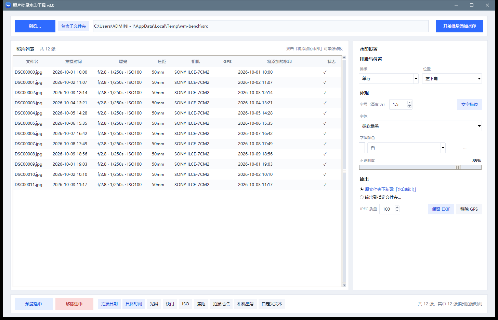

# 照片批量水印工具 · Photo Batch Watermarker

[](https://github.com/Sankh/photo-watermarker/actions/workflows/build.yml)
[](https://github.com/Sankh/photo-watermarker/releases/latest)
[](https://www.python.org/)
[](https://python-pillow.org/)
[](https://www.microsoft.com/windows)
[](LICENSE)

中文 | [English](#english)

一个**完全本地运行**的 Windows 桌面小工具：读取照片 EXIF，把拍摄时间、光圈快门 ISO、焦距、地点、相机型号或自定义文字，以水印形式压到画面角落。照片不上传、不联网、不改原图。



## 特性

- **批次处理**：选一个文件夹（可含子目录）或多张照片，先出列表确认，再一键写入。
- **EXIF 自动读取**：拍摄日期/时间、光圈、快门、ISO、焦距、相机型号、GPS；竖拍自动按方向转正。
- **水印内容逐项开关**：日期、时间、光圈、快门、ISO、焦距、地点、相机、自定义文本，各选各的。
- **单张可改**：双击列表里的「将添加的水印」单独改写，状态列标记 ✎。
- **排版灵活**：单行 / 多行；四角、四边中点、居中、自定义坐标百分比。
- **字体与颜色**：16 款常用字体 + 2 款复古相机液晶管字体（DSEG 7 段 / 14 段）；15 种常用颜色 + 取色器；描边颜色随字色亮度自动反转。
- **输出安全**：默认写到原文件夹下的「水印输出」子目录，原图不动；重名自动编号；EXIF 可保留，GPS 可一键剥离。
- **预览窗**：滚轮平移、Ctrl+滚轮缩放、拖动、←/→ 换图；大图先出低清快帧，停下来再补高清。

## 性能

在一台 i5-13500H / 32GB / 核显的笔记本上，用 12 张 6000×4000（24MP）JPEG 实测（v3.0）：

| 指标 | v2.1 | v3.0 | 提升 |
|---|---|---|---|
| 单张处理（串行） | 992 ms | 518 ms | **1.9×** |
| 批量吞吐（多线程） | 60.5 张/分钟 | **313 张/分钟** | **5.2×** |
| 预览首帧 | 441 ms | 186 ms | **2.4×** |
| 预览缩放一次（重绘） | ~120 ms | ~28 ms | **4×** |
| 启动到窗口（目录版） | — | 2.5 s | — |
| 启动到窗口（单文件版） | 9.4 s | 8.1 s | 1.2× |

优化要点：

- **单线程去重复解码**：预览/批量各自只解码一次，去掉"整图转 RGBA 再合成"的写法，只合成文字所在的小块。
- **JPEG draft 解码**：预览直接让 libjpeg 按 1/2 或 1/4 出图（`Image.draft`），省掉全分辨率解码。
- **预览重绘复用画布图像**：同一尺寸时用 `PhotoImage.paste()` 更新，不再每帧新建图像对象。
- **缩放分层**：先用低清工作图即时响应，缩放停下后再后台补全分辨率（`WORK_MAX` / 高清线程）。
- **批量并行**：`ThreadPoolExecutor` 多线程（Pillow 编解码时释放 GIL），实测 6 线程约为单线程 2.7 倍。
- **启动**：窗口图标改用 64px PNG（省 200ms），并推荐**目录版**（onefile 每次启动都要把上千个文件解包到临时目录，慢 3 倍）。

## 快速开始

### 用打包好的 exe（推荐）

1. 下载 Release 里的 `PhotoWatermark-v3.0-win64.zip`。
2. 解压到任意目录，双击 `PhotoWatermark.exe`。
3. 首次运行若遇到 SmartScreen，点「更多信息 → 仍要运行」。

> 目录版启动约 2.5 秒；单文件版（onefile）首次启动要解包，约 8 秒，二选一即可。

### 从源码运行

```bash
pip install -r requirements.txt
python src/photo_watermark.py
```

需要 Python 3.10+ 与 Pillow（tkinter 随 Python 自带）。

### 自己打包

```powershell
powershell -ExecutionPolicy Bypass -File build.ps1
```

产物：`dist/PhotoWatermark/`（目录版，推荐）与 `dist/PhotoWatermark.exe`（单文件版）。

## 使用

三步：

1. 左上角 **浏览…** 选文件夹或若干照片，自动读取并列出。
2. 底部一排胶囊按钮挑水印内容；右侧调排版、外观、输出；双击水印列可单张改写。
3. 右上角 **开始批量添加水印**，顶部地址栏变成进度条，完成弹窗汇总。

详细说明见 [使用说明](#)（仓库内 `docs/usage-zh.md`）。

## 结构

```
src/photo_watermark.py   主程序（单文件，约 2000 行，tkinter + Pillow）
assets/                  图标（ico/png）与液晶字体
docs/screenshots/        README 截图
build.ps1                Windows 打包脚本
.github/workflows/       CI：Windows 下打包并上传产物
```

## 说明与限制

- 仅支持常见的位图格式（JPG/JPEG/PNG/TIF/TIFF/WEBP），**不支持 RAW**（ARW/CR2/NEF…）。
- 液晶字体只含数字、英文字母与常用符号，**不含中文**。
- 离线程序不会把 GPS 反查成地址：可以填统一的「地点显示文字」，或对单张手写。
- 液晶字体 DSEG 由 keshikan 提供，见 `assets/fonts/DSEG-LICENSE.txt`（SIL OFL 1.1）。

## English

A local-only Windows desktop tool that stamps photo EXIF (date, aperture/shutter/ISO, focal length, place, camera, or custom text) onto images in batches. No upload, no network, originals untouched.

- Batch folder/file picker with a confirmation list, per-photo text override, single/multi-line layout, 9 positions, 16 fonts + 2 retro 7/14-segment LCD fonts, 15 colors + picker, auto-contrast outline.
- v3.0 performance: 1.9× faster single-image, 5.2× batch throughput (313 photos/min), 2.4× faster preview, ~28 ms per zoom repaint; onedir build starts in ~2.5 s.
- Run: `pip install -r requirements.txt && python src/photo_watermark.py`, or build with `build.ps1`.

## License

MIT © 2026 zach1174
